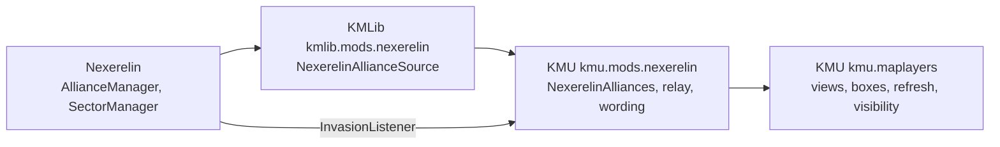

# Nexerelin

Facts about Nexerelin ("Nex") that KMU's map layers depend on or could use.
Nex is an optional mod that moves colonies between factions and keeps alliances,
neither of which vanilla does.
That makes it the main source of political change a map layer has to follow.

None of this is recoverable from KM source.
It was read out of Nex's own sources and checked against the versions below.

## Index

- [Versions this was verified against](#versions-this-was-verified-against)
- [How to re-verify](#how-to-re-verify)
- [How KM code reaches Nex](#how-km-code-reaches-nex)
  - [The soft-dependency rule](#the-soft-dependency-rule)
  - [What KM code binds to](#what-km-code-binds-to)
  - [Where the map layers read Nex](#where-the-map-layers-read-nex)
  - [What an alliance read costs](#what-an-alliance-read-costs)
- [What changed from 0.12.1e to 0.12.2d](#what-changed-from-0121e-to-0122d)
- [Nex concepts a map layer can read](#nex-concepts-a-map-layer-can-read)
  - [Blocs](#blocs)
  - [Relations between factions](#relations-between-factions)
  - [Ownership](#ownership)
  - [Operations against colonies](#operations-against-colonies)
  - [Strength and intent](#strength-and-intent)
  - [Faction configuration](#faction-configuration)
- [Listeners Nex fires](#listeners-nex-fires)
- [Traps](#traps)
- [Outstanding work](#outstanding-work)
  - [One alliance read per change](#one-alliance-read-per-change)
  - [Alliance events](#alliance-events)
  - [Original owner and occupied colonies](#original-owner-and-occupied-colonies)
  - [Ceasefires and relation caps](#ceasefires-and-relation-caps)
  - [Colonies under attack](#colonies-under-attack)
  - [Vassals](#vassals)

## Versions this was verified against

| What | Version | Identity |
| --- | --- | --- |
| Starsector | `0.98a-RC8` | - |
| Nexerelin | `0.12.2d` | `ExerelinCore.jar` SHA-256 `490b5964b3f9589ebfbd73f8285c468ccdab98890ca5582c26a573245cecb8b7`, 5132785 bytes; upstream tag `v0.12.2d` (`9b0ddac`) |

KMU's Nex integration was first written against `0.12.1e`.
[What changed](#what-changed-from-0121e-to-0122d) covers the span between the two.

## How to re-verify

Nex ships its own sources inside `ExerelinCore.jar`,
as `.java` and `.kt` files.
`/jar-search` keeps them in preference to a decompile,
so citations here carry real names and line numbers:
`<starsector>\.sources-cache\mods\Nexerelin\jars\ExerelinCore\`.
Search both extensions.

The cache is keyed on the jar's path,
and a Nex upgrade usually replaces the jar in place.
Re-extract with `-Force` after an upgrade,
then confirm the version in `mods\Nexerelin\mod_info.json`.

The changelog is at [the Nexerelin wiki](https://github.com/Histidine91/Nexerelin/wiki/Changelog).
Treat it as a lead:
it missed a change to who receives a conquered colony.
The source is public at [Histidine91/Nexerelin](https://github.com/Histidine91/Nexerelin),
tagged per release,
so two releases can be diffed exactly:

```bash
git clone --filter=blob:none --no-checkout https://github.com/Histidine91/Nexerelin.git nex-src
git -C nex-src diff --name-status v0.12.1e v0.12.2d -- '*.java' '*.kt'
```

Sources sit under `jars/sources/ExerelinCore/` in the repository.

## How KM code reaches Nex

### The soft-dependency rule

Nex is optional,
so a class naming an `exerelin.*` type must never load on an install without it.
Every such reference sits in a nested holder class,
reached only after `NexerelinPresence.isModEnabled()` has passed.
The game's loader bans reflection,
so a deferred class reference is the only way to do this.

Nex's managers read configuration in their static initialisers,
and several of those read the running sector.
A class whose static initialiser throws cannot be loaded again for the session.
So Nex classes are touched only from campaign-time code,
never from `onApplicationLoad`.

A Nex release that moves a symbol fails on the first call,
not at load.
Each read and install runs behind a guard,
and a failure is reported once through KMLib's compatibility channel
naming the feature it costs.

### What KM code binds to

Six couplings in all.
The mod ID is a string;
the rest link against Nex classes.

| KM class | Repo | Nex symbol | A rename costs |
| --- | --- | --- | --- |
| `NexerelinPresence` | KMLib | mod ID `nexerelin` | every Nex feature reads as absent |
| `NexerelinMarketTransferRelay` | KMU | implements `exerelin.utilities.InvasionListener` (4 abstract methods) | the transfer fast path; the poll still repaints |
| `NexerelinAllianceReader` | KMLib | `AllianceManager.getManager()`, `getAllianceList()`; `Alliance.uuId`, `getName()`, `getMembersSorted()` | every alliance read: view, contest, visibility |
| `NexerelinMarketTransfer` | KMLib | `SectorManager.transferMarket(market, newOwner, oldOwner, playerInvolved, isCapture, factionsToNotify, repChange)` | Nex's hand-over; the composed one runs instead |
| `NexerelinSubmarkets` | KMLib | `SectorManager.updateSubmarkets(market, oldOwnerId, newOwnerId)` | Nex's submarket rules on a hand-over |
| `NexerelinColoniser` | KMLib | `ColonyExpeditionIntel.createColonyStatic(market, planet, faction, ...)` | Nex's founding; the composed one runs instead |

All six hold on 0.12.2d with the signatures above.
`InvasionListener` is untouched since 0.12.1e,
and so are `transferMarket`, `updateSubmarkets` and `createColonyStatic`.
`AllianceManager.getAllianceList()` still dereferences the manager unchecked,
so the null check in `NexerelinAllianceReader` is still needed.

The relay is the fragile one.
`InvasionListener` has no default methods,
so a fifth method added by Nex would throw `AbstractMethodError` inside Nex's own transfer.
Nothing KMU guards reaches that frame;
the fix is a KMU release.

The last three are not map-layer code.
They are KMLib's colony operations,
listed because a Nex upgrade is checked against all of them at once.

### Where the map layers read Nex



`kmu.maplayers` imports `kmu.mods.nexerelin` and nothing of Nex itself;
the layering gate closes it to `exerelin`.

| Map-layer feature | Reads | Through |
| --- | --- | --- |
| Alliances view offered at all | mod presence | `MapLayers.selectPoliticalMapViews` |
| Alliances view paints alliances as one bloc | live alliance grouping | `AlliancesView` -> `NexerelinAlliances.resolveGrouping` |
| Allies are not rivals in bands and boxes | live alliance grouping | `DominancePaintedView`, `ClaimsView` -> `BlocAffiliation` |
| Hover boxes split allies from rivals | live alliance grouping | `SystemDominationTooltip`, `SystemClaimTooltip` |
| "Contested by" rather than "Present" | mod presence | `NexerelinContestWording` |
| An ally keeps a concealed colony's secret | live alliance membership | `MapLayers.registerFactionAlliances` -> `FactionAllianceRegistry` |
| Alliance changes repaint | alliance fingerprint, every poll | `PoliticalMapStalenessSource.markAllianceSetChange` |
| A conquest repaints at once | `InvasionListener.reportMarketTransfered` | relay -> `PoliticalMapMarketTransferListener` |
| Filter-row toggle tooltip mentions alliances | mod presence | `VanillaMapLayerToggleAttacher` |

An alliance change reaches the picture through the poll.
The fingerprint moving raises `PoliticalMapRefreshSignal.ALLIANCES`;
all three political views fold that revision into their content revision,
so the next map frame rebuilds the clusters and the sidebar picker re-resolves.
The hover box reads alliances live and needs no signal.
The [caching notes](caching.md) own that model,
and the [political map README](../../src/main/java/kmu/maplayers/politicalmap/README.md) owns how each feature behaves.

### What an alliance read costs

One read of the alliance records calls `Alliance.getMembersSorted()` once per alliance.
That method sums market sizes for every member,
scanning the economy's markets each time
(`exerelin/campaign/alliances/Alliance.java:97-111`).
KMLib memoises nothing:
`NexerelinAllianceSource` reads afresh on every ask.

| Reader | Reads per run | Runs |
| --- | --- | --- |
| Hover box, factions or alliances view (`SystemDominationTooltip`) | 2-3 | every frame while hovering |
| Hover box, claims view (`SystemClaimTooltip`) | 3 | every frame while hovering |
| Staleness poll: fingerprint, visibility pass, substrate sweep | 3 | every 4-5 campaign seconds by default, map open or not |
| Full cluster rebuild | 2-3, plus 1 on a geometry recut | on an `ALLIANCES` or settings change, map open |
| Incremental owner refresh | 1 | per batch of stale systems |
| Colony events (`MarketPoliticsRefresh`) | 1-2 | per colonisation, resize, discovery, transfer or decivilisation |

The hover box is the hot path.
It is rebuilt from the live sector on every paint
(`SystemCellTooltip`),
so hovering costs about 120-180 reads a second at 60 fps.
The visibility rule is cheap by comparison:
`ColonyKnowledge` reads alliances once per pass, not once per colony.

Only the bloc colour and the fingerprint's lead need the sort.
The visibility rule and the contest affiliation use membership alone,
which `Alliance.getMembersCopy()` gives without a scan.

None of the poll or hover reads sit under a profiling row,
so `kmu_profiling` cannot show this cost.
Rebuild reads show only as self time in `ownerMap.rebuildDrawables`, `ownerMap.resolveHolding` and `mapLayer.refresh`.

## What changed from 0.12.1e to 0.12.2d

Read off the tag diff, not only the changelog.
Only what a sector map would show is listed;
the rest is fleet AI, abilities, settings and bug fixes.

Ownership:

- **A commissioned player's conquest goes to the commissioner first.**
  `GroundBattleIntel.handleTransfer` hands a won battle to the commissioning faction
  (`exerelin/campaign/intel/groundbattle/GroundBattleIntel.java:1053-1056`).
  Keeping the colony then runs a second transfer to the player (`:1359-1362`).
  So one conquest can reach `InvasionListener` as two transfers.
  Not in the changelog.
- **`RequestMarketIntel` listens for transfers itself**
  and no longer re-transfers a colony to the faction already holding it.

Alliances:

- **Vassals**, through `VassalManager`, stored as ordinary alliances
  (see [Blocs](#blocs)).
- **`AllianceEventListener`** is new.
  Its `reportAllianceFormed` is never fired
  (see [Traps](#traps)).

Relations:

- Ceasefires last 240 days instead of 150,
  and a recent war 180 instead of 120.
- The diplomacy events that start a war now push relations below -50.
- An NPC invasion, raid or bombardment lowers relations between the two factions when it ends.
  `OffensiveFleetIntel.getRepEffect()` states the change.
- 0.12.2c fixed that loss being 100 times too large.
  It had made some factions hostile to themselves,
  and Nex resets those on load.
- `DiplomacyManager.getMaxRelationshipStat` breaks the relation cap down by reason.
- Three new diplomacy traits: `domain_claimant`, `domain_loyalist`, `domain_rebel`.
  Only the Hegemony ships with one (`domain_claimant`).

Offensives:

- A global cooldown between invasions and raids:
  `OffensiveFleetIntel.isOffensiveCooldown()`.
- An offensive no longer aborts when an ally takes its source colony.

Factions:

- Derelict Empire (`nex_derelict`) starts hostile to everyone.

## Nex concepts a map layer can read

Paths are relative to the sources cache root.
"Poll" means Nex fires nothing when the value changes.

### Blocs

**Alliances.**
`AllianceManager.getAllianceList()`, `getFactionAlliance(id)`, `areFactionsAllied(a, b)`.
Each `Alliance` carries `uuId`, `getName()`, `getMembersCopy()` and `getAlignment()`.
Changes fire `AllianceEventListener`,
through the sector's listener manager
(`exerelin/campaign/AllianceManager.java:1120-1153`).
It reports a faction joining, leaving, two alliances merging,
one dissolving and a vote.
It never reports one forming:
a new alliance shows only as a new `uuId` in the list.
Nor does anything report the lead member changing,
which follows market sizes.
The events fire synchronously, inside the `AllianceManager` call,
and some fire mid-change:
a dissolving alliance reports each member leaving while it still lists them all.
`VassalManager` is itself a listener and joins or leaves alliances from inside those events,
so one change can arrive as several.

**Vassals.**
New in 0.12.2.
A vassal and its overlord share an ordinary `Alliance`:
`VassalManager.vassalize` calls `AllianceManager.createAlliance`
(`exerelin/campaign/diplomacy/VassalManager.java:54-71`).
Nothing on the `Alliance` marks it.
Ask `VassalManager.getInstance().isVassal(id)` and `getOverlord(id)` instead;
`getInstance()` is null until Nex's `onGameLoad` creates it.
Becoming a vassal fires nothing.
In 0.12.2d no gameplay path calls `vassalize` -
only scripts and the console do.

### Relations between factions

**War and peace.**
Nex keeps no war flag of its own.
War is vanilla `RepLevel.HOSTILE`,
read through `FactionAPI.isHostileTo`.
`DiplomacyManager.getManager().getLastWarTimestamp()` moves whenever any war starts,
which makes it a cheap fingerprint for new wars only.

**Ceasefires and recent wars.**
Each faction's `DiplomacyBrain` holds both as a map of other faction to days remaining:
`getCeasefires()` and `getRecentWars()`.
They return the live maps, so copy before holding them.
Reach a brain through `DiplomacyManager.getManager().getDiplomacyBrains().get(id)`;
`getDiplomacyBrain(id)` creates and saves a brain on a miss
(`exerelin/campaign/DiplomacyManager.java:1009-1015`).
A ceasefire lasts 240 days and a recent war 180
(`CEASEFIRE_LENGTH`, `RECENT_WAR_LENGTH`, `exerelin/campaign/diplomacy/DiplomacyBrain.java:109-110`).
A recent war blocks peace talks,
and a ceasefire blocks a new war.
Both brains of a pair usually hold the same ceasefire,
but the brains of factions Nex keeps out of diplomacy
(independents, the Luddic Path, Templars, `disableDiplomacy`)
never count down, so their entries can be stale.
No Nex screen shows either map or the days left.
Poll.

**Dispositions.**
How much one faction's AI likes another,
as a `MutableStat` whose modifiers name the reasons.
Read `brain.getDispositionsList()`.
`DiplomacyBrainListener.reportDispositionsUpdated` fires when a brain recomputes,
roughly every 20 days.

**Maximum relation.**
`DiplomacyManager.getManager().getMaxRelationship(a, b)` caps how friendly two factions can get.
`getMaxRelationshipStat` gives the breakdown.
Both write an empty `$nex_max_relations` map into faction memory on a miss,
and both throw while the manager is null.
Nex shows the cap only against the player's faction.
Effectively static.

**Diplomacy traits.**
`DiplomacyTraits.getFactionTraits(id)`, `hasTrait(id, trait)`.
0.12.2d adds `domain_claimant`, `domain_loyalist` and `domain_rebel`;
their only effect is a disposition modifier between those factions.

**War weariness and warmongering.**
`DiplomacyManager.getWarWeariness(id)` per faction, updated every 3 days.
`DiplomacyManager.getBadboy(faction)`, faction memory `$nex_badboy`,
rises when a faction takes a colony from its original owner.
Poll.
Both suit a tooltip line better than a cell colour.

### Ownership

**Original owner.**
`$startingFactionId` in market memory
(`ExerelinConstants.MEMKEY_MARKET_STARTING_FACTION`),
read by `NexUtilsMarket.getOriginalOwner(market)` and `isWithOriginalOwner(market)`
(`exerelin/utilities/NexUtilsMarket.java:139-168`).
It is a plain memory key,
so it can be read without loading a Nex class.
Nex calls a colony held by someone else its original owner's claim,
shows those claims on its faction directory and diplomacy profile,
and runs its revanchism on them.

Not every market has it.
Nex writes it once over the economy's markets:
at a new game,
or when Nex is added to an existing save
(`exerelin/plugins/ExerelinModPlugin.java:198-206`, `:729-740`).
After that only Nex's own colony foundings,
player colonies and random-sector markets get it.
Pirate and Luddic Path bases spawned later,
Nex's respawn bases and player outposts,
and colonies other mods add later never do.
Nothing backfills it on load.

It is never rewritten on capture.
On a save Nex was added to mid-campaign,
"original" means the owner when Nex was installed.

**Recent capture.**
`$nex_recentlyCapturedFrom` holds the previous owner for 90 days after a capture
(`exerelin/campaign/SectorManager.java:66-68`).

**Live factions.**
`SectorManager.isFactionAlive(id)` and `getLiveFactionIdsCopy()`.
Rechecked every half day.
Poll.

**System claims.**
Nex adds none.
`NexUtilsFaction.getClaimingFaction` is vanilla's claim plus the player.

**Colony flags.**
`$nex_uninvadable`, `$nex_npc_no_invade` and `$nex_do_not_colonize` on market memory;
`NexUtilsMarket.canBeInvaded(market)` combines them.

### Operations against colonies

Invasions, raids, blockades, saturation bombardments, base strikes,
counter-invasions and colony expeditions all extend `OffensiveFleetIntel`.
`getTarget()` is the market,
`getFaction()` and `getTargetFaction()` the two sides,
and a null `getOutcome()` means it is still running.

`IntelManager.getIntel(OffensiveFleetIntel.class)` finds every one the player has been told about;
vanilla's intel repository indexes each item under its superclasses.
An item is the player's to see while it is in that list,
`isPlayerVisible()` holds,
and it is not ending.
Nex lists every offensive in the sector this way,
not only those against the player.

`GroundBattleIntel.getOngoing()` lists ground battles,
which Nex always announces.
`RebellionIntel` is found by an intel scan;
`$nex_rebellionPoints` on market memory (0-100) is the cheap unrest gauge.

Listeners cover only part of it.
`GroundBattleCampaignListener` fires when a battle starts and ends,
`RaidListener` when an offensive ends,
and `StrategicAIListener` for strategic-AI actions.
Most offensive launches and rebellions need a poll.

The colony-threat research for 0.12.1e
([research-nexerelin.md](implementation/021-colony-threat-report-and-map/research-nexerelin.md))
catalogues these in depth.
Its class and method names still hold in 0.12.2d;
its line numbers and its 150-day ceasefire do not.

### Strength and intent

**Fleet and ground pools.**
New in 0.12.2,
replacing invasion points.
Per market,
`$nex_fleetPoolPointsLastTick` and `$nex_groundPoolPointsLastTick` on market memory
say what each colony adds,
readable without a Nex class.
Per faction,
`FleetPoolManager.getManager().getCurrentPool(id)`.
Refreshed daily.
Poll.

**Strategic AI.**
`StrategicAI.getAI(id).getExistingConcerns()` lists what each faction's AI is weighing,
each concern naming its markets and factions.
`StrategicAIListener` fires as concerns and actions come and go.

**Covert operations.**
`CovertOpsManager.getManager().getOngoingCovertActionsOfType(CovertActionIntel.class)`
names each action's market and two factions.
`AgentActionListener` fires on completion only.

**Faction recognition.**
`FactionRecognitionIntel` is new in 0.12.2.
It tracks the player alone and is cosmetic in 0.12.2d,
so there is nothing for a map to paint.

### Faction configuration

`NexConfig.getFactionConfig(id)` returns a `NexFactionConfig`.
The flags that bear on painting:

| Flag | Meaning |
| --- | --- |
| `playableFaction` | false keeps a faction out of Nex's live factions and invasion targets |
| `pirateFaction` | pirate behaviour |
| `hostileToAll` | 0-3, how hostile to everyone |
| `disableDiplomacy` | the faction takes no part in diplomacy |

`nex_derelict` (Derelict Empire) is unplayable and hostile to everyone.
Treat it as a hostile bloc,
never as anyone's original owner.

## Listeners Nex fires

Every one dispatches through `Global.getSector().getListenerManager()`,
so a listener is registered there,
and a transient registration keeps it out of the save.
Being read off `Global`,
they reach only the sector currently running.

| Listener | Fires on |
| --- | --- |
| `exerelin.utilities.InvasionListener` | a colony changing hands, invasion rounds, loot, an invasion ending |
| `exerelin.campaign.alliances.AllianceEventListener` | a faction joining or leaving an alliance, alliances merging, one dissolving, a vote |
| `DiplomacyBrainListener` | a faction's dispositions recomputed |
| `StrategicAIListener` | strategic AI concerns and actions added, updated, removed |
| `RaidListener` | an offensive ending |
| `GroundBattleCampaignListener` | a ground battle starting and ending |
| `AgentActionListener` | a covert action completing |

`AllianceEventListener` exists from 0.12.2 only.

## Traps

- **`reportAllianceFormed` never fires.**
  `AllianceManager` defines the dispatch (`:1120`) and nothing calls it.
  A listener alone misses every new alliance;
  the poll still catches it.
- **One conquest can be two transfers.**
  See [What changed](#what-changed-from-0121e-to-0122d).
  A listener should read the second as an ordinary transfer,
  not as a repeat to ignore.
- **`Alliance.getMembersSorted()` scans the economy.**
  See [What an alliance read costs](#what-an-alliance-read-costs).
- **The bloc colour can come from a vassal.**
  `getMembersSorted()` ranks by market size,
  so a vassal with more colonies than its overlord leads the alliance.
- **`VassalManager.getLibertyDesire()` deletes what it returns**
  (`exerelin/campaign/diplomacy/VassalManager.java:123-125`).
- **Some reads write.**
  `DiplomacyBrain.getDisposition(id)` creates and computes an entry on a miss,
  and that includes a full market scan.
  `DiplomacyManager.getDiplomacyBrain(id)` creates a brain.
  `getMaxRelationship` writes faction memory.
  `getWarWeariness(id)` and `ResourcePoolManager.getCurrentPool(id)` insert a default.
  Read the lists and maps instead where one exists.
- **A disabled pool reads 1,000,000.**
- **Queued intel is not the player's yet.**
  Nex can queue intel instead of adding it
  (`exerelin/campaign/intel/FilterableIntel.java:41-53`),
  and the comm queue holds what the player has not received.
  A map reading it would reveal what the intel screen hides.
- **Some Nex lists ignore what the player knows.**
  `InvasionFleetManager.getActiveIntelCopy()` includes offensives never announced,
  and a rebellion's market condition is added while its intel is still queued.
- **`ColonyExpeditionIntel.getTarget()` is not empty space.**
  It returns the planet's condition-only market;
  `getTargetPlanet()` gives the body.

## Outstanding work

What the map layers do not take from Nex yet,
and the decisions each needs before a design.

### One alliance read per change

The hover box reads alliances two or three times a frame,
and each read scans the economy once per alliance member
([What an alliance read costs](#what-an-alliance-read-costs)).
The fix is a per-sector snapshot,
re-folded only when the `ALLIANCES` revision moves.
Hover and rebuild reads would drop to an int compare,
and the box would go stale on the same counter as the fills.
A read using `getMembersCopy()` would take the scan out of every membership-only fold.

Decisions:

- Where the snapshot lives.
  KMLib has no revision to key it on,
  and `base` may not name the political map's signal,
  so `FactionAllianceRegistry` would take the snapshot from its caller rather than from the signal.
- How the snapshot is seeded at install,
  and kept fresh for the visibility sweep while the political map is off.
- Whether the poll and hover box get profiling rows first,
  so the saving can be measured.

### Alliance events

`AllianceEventListener` could raise `ALLIANCES` the moment a faction joins, leaves, merges or dissolves,
instead of on the next poll.
The board is a pair of atomic counters,
so bumping it from inside Nex's call is safe.
This buys latency, not cost:
the poll stays,
since Nex reports neither a new alliance nor a change of lead.
It matters most for a change made in a paused dialog,
where the poll does not run,
and it becomes necessary once the snapshot above is cached.

The shape follows the [conquest relay](#where-the-map-layers-read-nex):
a KMU-owned contract in `kmu.starsector.listeners`,
a relay in `kmu.mods.nexerelin` implementing all six methods,
and a sixth listener in `PoliticalMapInstaller`.
It needs its own installer holder,
since the interface exists from 0.12.2 only
and a link error must not take the conquest relay down with it.

### Original owner and occupied colonies

A view, or a hover line, could show which colonies are held by someone other than their original owner
([Ownership](#ownership)).
The cheapest seam is a word on `ColonyQualifier` in the political hover box.
A view would be a fourth holder provider beside the claims view's;
a fill state would be a framework change,
both exceptions to the solid fill already being taken.

Decisions:

- Hover line, view or fill state.
- A system's rule when its colonies have different original owners.
- How to show a colony with no recorded owner,
  apart from an install without Nex.
- What to call it:
  Nex says "claim",
  and KMU's Claims view already means vanilla's claim.
- Whether `$nex_recentlyCapturedFrom` is shown as recent capture.
- Whether a save Nex joined mid-campaign is treated any differently.

### Ceasefires and relation caps

The planned diplomatic map paints by relation alone,
and its hatch already means mixed relations,
so ceasefires, recent wars and caps fit as hover annotations without changing its settled design
([Relations between factions](#relations-between-factions)).

Decisions:

- Hover only, or painted on a new channel.
- Whether to show days remaining,
  which Nex itself never shows.
- Which side's brain counts, and how an alliance target reads.
- Whether a cap is shown against any faction,
  or only against the player's as Nex does.

### Colonies under attack

Offensives, ground battles and rebellions name the colony they target
([Operations against colonies](#operations-against-colonies)).
The colony-threat research
([021](implementation/021-colony-threat-report-and-map/research.md))
proposed a report and map for the player's own colonies.
It has no problem statement or plan,
and predates the map-layer framework.

Decisions:

- Whether this revives 021 or replaces it.
- The player's colonies only, or every colony.
- A layer of its own, or annotations on the political map.
- Which operations count.

### Vassals

The alliances view paints a vassal as an ordinary member,
and may colour the alliance after it
([Blocs](#blocs)).
No gameplay path makes a vassal in 0.12.2d,
so nothing needs doing until one does.
