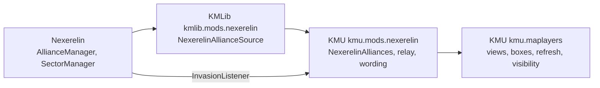

# Nexerelin

Facts about Nexerelin ("Nex") that KMU's map layers depend on or could use.
Nex is an optional mod that moves colonies between factions and keeps alliances,
neither of which vanilla does.
That makes it the main source of political change a map layer has to follow.

None of this is recoverable from KM source.
It was read out of Nex's own sources and checked against the versions below.

## Index

- [Versions this was verified against](#versions-this-was-verified-against)
- [How to re-verify](#how-to-re-verify)
- [How KM code reaches Nex](#how-km-code-reaches-nex)
  - [The soft-dependency rule](#the-soft-dependency-rule)
  - [What KM code binds to](#what-km-code-binds-to)
  - [Where the map layers read Nex](#where-the-map-layers-read-nex)
- [What changed from 0.12.1e to 0.12.2d](#what-changed-from-0121e-to-0122d)
- [Nex concepts a map layer can read](#nex-concepts-a-map-layer-can-read)
  - [Blocs](#blocs)
  - [Relations between factions](#relations-between-factions)
  - [Ownership](#ownership)
  - [Operations against colonies](#operations-against-colonies)
  - [Strength and intent](#strength-and-intent)
  - [Faction configuration](#faction-configuration)
- [Listeners Nex fires](#listeners-nex-fires)
- [Traps](#traps)
- [Integration tracker](#integration-tracker)

## Versions this was verified against

| What | Version | Identity |
| --- | --- | --- |
| Starsector | `0.98a-RC8` | - |
| Nexerelin | `0.12.2d` | `ExerelinCore.jar` SHA-256 `490b5964b3f9589ebfbd73f8285c468ccdab98890ca5582c26a573245cecb8b7`, 5132785 bytes; upstream tag `v0.12.2d` (`9b0ddac`) |

KMU's Nex integration was first written against `0.12.1e`.
[What changed](#what-changed-from-0121e-to-0122d) covers the span between the two.

## How to re-verify

Nex ships its own Java sources inside `ExerelinCore.jar`.
`/jar-search` keeps them in preference to a decompile,
so citations here carry real names and line numbers:
`<starsector>\.sources-cache\mods\Nexerelin\jars\ExerelinCore\`.

The cache is keyed on the jar's path,
and a Nex upgrade usually replaces the jar in place.
Re-extract with `-Force` after an upgrade,
then confirm the version in `mods\Nexerelin\mod_info.json`.

The changelog is at [the Nexerelin wiki](https://github.com/Histidine91/Nexerelin/wiki/Changelog).
Treat it as a lead.
The source is public at [Histidine91/Nexerelin](https://github.com/Histidine91/Nexerelin),
tagged per release,
so two releases can be diffed exactly:

```bash
git clone --filter=blob:none --no-checkout https://github.com/Histidine91/Nexerelin.git nex-src
git -C nex-src diff --name-status v0.12.1e v0.12.2d -- '*.java'
```

Java sources sit under `jars/sources/ExerelinCore/` in the repository.

## How KM code reaches Nex

### The soft-dependency rule

Nex is optional,
so a class naming an `exerelin.*` type must never load on an install without it.
Every such reference sits in a nested holder class,
reached only after `NexerelinPresence.isModEnabled()` has passed.
The game's loader bans reflection,
so a deferred class reference is the only way to do this.

Nex's managers read configuration in their static initialisers,
and several of those read the running sector.
A class whose static initialiser throws cannot be loaded again for the session.
So Nex classes are touched only from campaign-time code,
never from `onApplicationLoad`.

A Nex release that moves a symbol fails on the first call,
not at load.
Each read and install runs behind a guard,
and a failure is reported once through KMLib's compatibility channel
naming the feature it costs.

### What KM code binds to

Six couplings in all.
The mod ID is a string;
the rest link against Nex classes.

| KM class | Repo | Nex symbol | A rename costs |
| --- | --- | --- | --- |
| `NexerelinPresence` | KMLib | mod ID `nexerelin` | every Nex feature reads as absent |
| `NexerelinMarketTransferRelay` | KMU | implements `exerelin.utilities.InvasionListener` (4 abstract methods) | the transfer fast path; the poll still repaints |
| `NexerelinAllianceReader` | KMLib | `AllianceManager.getManager()`, `getAllianceList()`; `Alliance.uuId`, `getName()`, `getMembersSorted()` | every alliance read: view, contest, visibility |
| `NexerelinMarketTransfer` | KMLib | `SectorManager.transferMarket(market, newOwner, oldOwner, playerInvolved, isCapture, factionsToNotify, repChange)` | Nex's hand-over; the composed one runs instead |
| `NexerelinSubmarkets` | KMLib | `SectorManager.updateSubmarkets(market, oldOwnerId, newOwnerId)` | Nex's submarket rules on a hand-over |
| `NexerelinColoniser` | KMLib | `ColonyExpeditionIntel.createColonyStatic(market, planet, faction, ...)` | Nex's founding; the composed one runs instead |

All six hold on 0.12.2d with the signatures above.
`InvasionListener` is untouched since 0.12.1e,
and so are `transferMarket`, `updateSubmarkets` and `createColonyStatic`.
`AllianceManager.getAllianceList()` still dereferences the manager unchecked,
so the null check in `NexerelinAllianceReader` is still needed.

The relay is the fragile one.
`InvasionListener` has no default methods,
so a fifth method added by Nex would throw `AbstractMethodError` inside Nex's own transfer.
Nothing KMU guards reaches that frame;
the fix is a KMU release.

The last three are not map-layer code.
They are KMLib's colony operations,
listed because a Nex upgrade is checked against all of them at once.

### Where the map layers read Nex



`kmu.maplayers` imports `kmu.mods.nexerelin` and nothing of Nex itself.
Nex types stop at `kmu.mods.nexerelin` and `kmlib.mods.nexerelin`.

| Map-layer feature | Reads | Through |
| --- | --- | --- |
| Alliances view offered at all | mod presence | `MapLayers.selectPoliticalMapViews` |
| Alliances view paints alliances as one bloc | live alliance grouping | `AlliancesView` -> `NexerelinAlliances.resolveGrouping` |
| Allies are not rivals in bands and boxes | live alliance grouping | `DominancePaintedView`, `ClaimsView` -> `BlocAffiliation` |
| Hover boxes split allies from rivals | live alliance grouping, sampled per hover | `SystemDominationTooltip`, `SystemClaimTooltip` |
| "Contested by" rather than "Present" | mod presence | `NexerelinContestWording` |
| An ally keeps a concealed colony's secret | live alliance membership | `MapLayers.registerFactionAlliances` -> `FactionAllianceRegistry` |
| Alliance changes repaint | alliance fingerprint, every poll | `PoliticalMapStalenessSource.markAllianceSetChange` |
| A conquest repaints at once | `InvasionListener.reportMarketTransfered` | relay -> `PoliticalMapMarketTransferListener` |
| Filter-row toggle tooltip mentions alliances | mod presence | `VanillaMapLayerToggleAttacher` |

The [political map README](../../src/main/java/kmu/maplayers/politicalmap/README.md) owns how each of these behaves.

## What changed from 0.12.1e to 0.12.2d

Read off the tag diff, not only the changelog.
Only what a sector map would show is listed;
the rest is fleet AI, abilities, settings and bug fixes.

Ownership:

- **A commissioned player's conquest goes to the commissioner first.**
  `GroundBattleIntel.handleTransfer` hands a won battle to the commissioning faction
  (`exerelin/campaign/intel/groundbattle/GroundBattleIntel.java:1053-1056`).
  Keeping the colony then runs a second transfer to the player (`:1359-1362`).
  So one conquest can reach `InvasionListener` as two transfers.
  Not in the changelog.
- **`RequestMarketIntel` listens for transfers itself**
  and no longer re-transfers a colony to the faction already holding it.

Alliances:

- **Vassals**, through `VassalManager`, stored as ordinary alliances
  (see [Blocs](#blocs)).
- **`AllianceEventListener`** is new.
  Its `reportAllianceFormed` is never fired
  (see [Traps](#traps)).

Relations:

- Ceasefires last 240 days instead of 150,
  and a recent war 180 instead of 120.
- The diplomacy events that start a war now push relations below -50.
- An NPC invasion, raid or bombardment lowers relations between the two factions when it ends.
  `OffensiveFleetIntel.getRepEffect()` states the change.
- 0.12.2c fixed that loss being 100 times too large.
  It had made some factions hostile to themselves,
  and Nex resets those on load.
- `DiplomacyManager.getMaxRelationshipStat` breaks the relation cap down by reason.
- Three new diplomacy traits: `domain_claimant`, `domain_loyalist`, `domain_rebel`.
  Only the Hegemony ships with one (`domain_claimant`).

Offensives:

- A global cooldown between invasions and raids:
  `OffensiveFleetIntel.isOffensiveCooldown()`.
- An offensive no longer aborts when an ally takes its source colony.

Factions:

- Derelict Empire (`nex_derelict`) starts hostile to everyone.

## Nex concepts a map layer can read

Paths are relative to the sources cache root.
"Poll" means Nex fires nothing when the value changes.

### Blocs

**Alliances.**
`AllianceManager.getAllianceList()`, `getFactionAlliance(id)`, `areFactionsAllied(a, b)`.
Each `Alliance` carries `uuId`, `getName()`, `getMembersCopy()` and `getAlignment()`.
Changes fire `AllianceEventListener`,
through the sector's listener manager
(`exerelin/campaign/AllianceManager.java:1120-1153`).
It reports a faction joining, leaving, two alliances merging,
one dissolving and a vote.
It never reports one forming:
a new alliance shows only as a new `uuId` in the list.
The events fire synchronously, inside the `AllianceManager` call.
`VassalManager` is itself a listener and joins or leaves alliances from inside those events,
so one change can arrive as several.

**Vassals.**
New in 0.12.2.
A vassal and its overlord share an ordinary `Alliance`:
`VassalManager.vassalize` calls `AllianceManager.createAlliance`
(`exerelin/campaign/diplomacy/VassalManager.java:54-71`).
Nothing on the `Alliance` marks it.
Ask `VassalManager.getInstance().isVassal(id)` and `getOverlord(id)` instead;
`getInstance()` is null until Nex's `onGameLoad` creates it.
Becoming a vassal fires nothing.
In 0.12.2d no gameplay path calls `vassalize` -
only scripts and the console do.

### Relations between factions

**War and peace.**
Nex keeps no war flag of its own.
War is vanilla `RepLevel.HOSTILE`,
read through `FactionAPI.isHostileTo`.
`DiplomacyManager.getManager().getLastWarTimestamp()` moves whenever any war starts,
which makes it a cheap fingerprint for new wars only.

**Ceasefires and recent wars.**
Per directed pair, in days remaining:
`DiplomacyBrain.getCeasefires()` and `getRecentWars()`,
reached through `DiplomacyManager.getManager().getDiplomacyBrain(id)`.
A ceasefire lasts 240 days and a recent war 180
(`CEASEFIRE_LENGTH`, `RECENT_WAR_LENGTH`, `exerelin/campaign/diplomacy/DiplomacyBrain.java:109-110`).
Poll.

**Dispositions.**
How much one faction's AI likes another,
as a `MutableStat` whose modifiers name the reasons.
Read `brain.getDispositionsList()`.
`DiplomacyBrainListener.reportDispositionsUpdated` fires when a brain recomputes,
roughly every 20 days.

**Maximum relation.**
`DiplomacyManager.getManager().getMaxRelationship(a, b)` caps how friendly two factions can get.
`getMaxRelationshipStat` gives the breakdown.
Effectively static,
so a pair that can never reach peace can be marked once.

**Diplomacy traits.**
`DiplomacyTraits.getFactionTraits(id)`, `hasTrait(id, trait)`.
0.12.2d adds `domain_claimant`, `domain_loyalist` and `domain_rebel`;
their only effect is a disposition modifier between those factions.

**War weariness and warmongering.**
`DiplomacyManager.getWarWeariness(id)` per faction, updated every 3 days.
`DiplomacyManager.getBadboy(faction)`, faction memory `$nex_badboy`,
rises when a faction takes a colony from its original owner.
Poll.
Both suit a tooltip line better than a cell colour.

### Ownership

**Original owner.**
Every market carries `$startingFactionId` in its memory
(`ExerelinConstants.MEMKEY_MARKET_STARTING_FACTION`),
set at sector start and when a colony is founded.
`NexUtilsMarket.getOriginalOwner(market)` and `isWithOriginalOwner(market)` read it
(`exerelin/utilities/NexUtilsMarket.java:139-168`).
It is a plain memory key,
so it can be read without loading a Nex class.
Nex's own revanchism runs on it,
which makes it Nex's real notion of a claim.

**Recent capture.**
`$nex_recentlyCapturedFrom` holds the previous owner for 90 days after a capture
(`exerelin/campaign/SectorManager.java:66-68`).

**Live factions.**
`SectorManager.isFactionAlive(id)` and `getLiveFactionIdsCopy()`.
Rechecked every half day.
Poll.

**System claims.**
Nex adds none.
`NexUtilsFaction.getClaimingFaction` is vanilla's claim plus the player.

**Colony flags.**
`$nex_uninvadable`, `$nex_npc_no_invade` and `$nex_do_not_colonize` on market memory;
`NexUtilsMarket.canBeInvaded(market)` combines them.

### Operations against colonies

Invasions, raids, blockades, saturation bombardments, base strikes,
counter-invasions and colony expeditions all extend `OffensiveFleetIntel`.
`getTarget()` is the market,
`getFaction()` and `getTargetFaction()` the two sides,
and a null `getOutcome()` means it is still running.
Enumerate with `IntelManager.getIntel(OffensiveFleetIntel.class)`
together with `getCommQueue(OffensiveFleetIntel.class)`.
`RaidListener.reportRaidEnded` fires when one ends;
most launches fire nothing,
so starts need a poll.

`GroundBattleIntel.getOngoing()` lists ground battles,
and `GroundBattleCampaignListener` fires on start and end.
`RebellionIntel` is found by an intel scan;
`$nex_rebellionPoints` on market memory (0-100) is the cheap unrest gauge.

The colony-threat research for 0.12.1e
([research-nexerelin.md](implementation/021-colony-threat-report-and-map/research-nexerelin.md))
catalogues these in depth.
Its class and method names still hold in 0.12.2d;
its line numbers do not.

### Strength and intent

**Fleet and ground pools.**
New in 0.12.2,
replacing invasion points.
Per market,
`$nex_fleetPoolPointsLastTick` and `$nex_groundPoolPointsLastTick` on market memory
say what each colony adds,
readable without a Nex class.
Per faction,
`FleetPoolManager.getManager().getCurrentPool(id)`.
Refreshed daily.
Poll.

**Strategic AI.**
`StrategicAI.getAI(id).getExistingConcerns()` lists what each faction's AI is weighing,
each concern naming its markets and factions.
`StrategicAIListener` fires as concerns and actions come and go.

**Covert operations.**
`CovertOpsManager.getManager().getOngoingCovertActionsOfType(CovertActionIntel.class)`
names each action's market and two factions.
`AgentActionListener` fires on completion only.

### Faction configuration

`NexConfig.getFactionConfig(id)` returns a `NexFactionConfig`.
The flags that bear on painting:

| Flag | Meaning |
| --- | --- |
| `playableFaction` | false keeps a faction out of Nex's live factions and invasion targets |
| `pirateFaction` | pirate behaviour |
| `hostileToAll` | 0-3, how hostile to everyone |
| `disableDiplomacy` | the faction takes no part in diplomacy |

`nex_derelict` (Derelict Empire) is unplayable and hostile to everyone.
Treat it as a hostile bloc,
never as anyone's original owner.

## Listeners Nex fires

Every one dispatches through `Global.getSector().getListenerManager()`,
so a listener is registered there,
and a transient registration keeps it out of the save.
Being read off `Global`,
they reach only the sector currently running.

| Listener | Fires on |
| --- | --- |
| `exerelin.utilities.InvasionListener` | a colony changing hands, invasion rounds, loot, an invasion ending |
| `exerelin.campaign.alliances.AllianceEventListener` | alliance formed, joined, left, merged, dissolved, voted on |
| `DiplomacyBrainListener` | a faction's dispositions recomputed |
| `StrategicAIListener` | strategic AI concerns and actions added, updated, removed |
| `RaidListener` | an offensive ending |
| `GroundBattleCampaignListener` | a ground battle starting and ending |
| `AgentActionListener` | a covert action completing |

## Traps

- **`reportAllianceFormed` never fires.**
  `AllianceManager` defines the dispatch (`:1120`) and nothing calls it.
  A listener alone misses every new alliance;
  the poll still catches it.
- **One conquest can be two transfers.**
  See [What changed](#what-changed-from-0121e-to-0122d).
  A listener should read the second as an ordinary transfer,
  not as a repeat to ignore.
- **`Alliance.getMembersSorted()` scans the economy.**
  It sums market sizes for every member on every call
  (`exerelin/campaign/alliances/Alliance.java:97-111`).
  KMU calls it once per alliance on every poll and on every hover.
- **The bloc colour can come from a vassal.**
  `getMembersSorted()` ranks by market size,
  so a vassal with more colonies than its overlord leads the alliance.
- **`VassalManager.getLibertyDesire()` deletes what it returns**
  (`exerelin/campaign/diplomacy/VassalManager.java:123-125`).
- **Some reads write.**
  `DiplomacyBrain.getDisposition(id)` creates and computes an entry on a miss,
  and that includes a full market scan.
  `getDiplomacyBrain(id)` creates a brain.
  `getWarWeariness(id)` and `ResourcePoolManager.getCurrentPool(id)` insert a default.
  Read the lists instead where one exists.
- **A disabled pool reads 1,000,000.**
- **Queued intel is invisible to `getIntel`.**
  Nex can queue intel instead of adding it (`exerelin/campaign/intel/FilterableIntel.java:41-53`).
  The default setting queues nothing,
  but a scan should take the comm queue too.
- **`InvasionFleetManager.getActiveIntelCopy()` is not every offensive.**
  It leaves out base strikes and anything another manager launched.
- **`ColonyExpeditionIntel.getTarget()` is not empty space.**
  It returns the planet's condition-only market;
  `getTargetPlanet()` gives the body.

## Integration tracker

What KMU's map layers take from Nex,
and what they could.

| Item | Layer | Nex source | Change signal | State |
| --- | --- | --- | --- | --- |
| Alliances view | Political map | `AllianceManager` | fingerprint poll | integrated |
| Alliance-aware contest | Political map | `AllianceManager` | fingerprint poll | integrated |
| Contest wording | Political map | mod presence | none needed | integrated |
| Allies keep secrets | all owner-painted layers | `AllianceManager` | read per rebuild | integrated |
| Conquest fast path | Political map | `InvasionListener` | listener | integrated |
| Alliance changes by event | Political map | `AllianceEventListener` | listener; the poll stays for formation | candidate |
| One alliance read per poll | Political map | `Alliance.getMembersSorted` | - | candidate |
| Vassals shown as vassals | Political map, alliances view | `VassalManager` | poll | candidate, low: no gameplay path makes a vassal yet |
| Original owner and occupied colonies | Political map | `$startingFactionId`, `$nex_recentlyCapturedFrom` | `InvasionListener` | candidate |
| Ceasefires, recent wars, relation caps | Diplomatic map | `DiplomacyBrain`, `DiplomacyManager` | poll | candidate |
| Colonies under attack | threat annotation | `OffensiveFleetIntel`, `GroundBattleIntel`, `RebellionIntel` | listeners plus poll | candidate |
| Military weight per colony | metric | `$nex_fleetPoolPointsLastTick` | poll | candidate |
| Eliminated factions | legend, pickers | `SectorManager.isFactionAlive` | poll | candidate |
| Faction recognition | - | `FactionRecognitionIntel` | - | not pursued: player-only and cosmetic in 0.12.2d |
