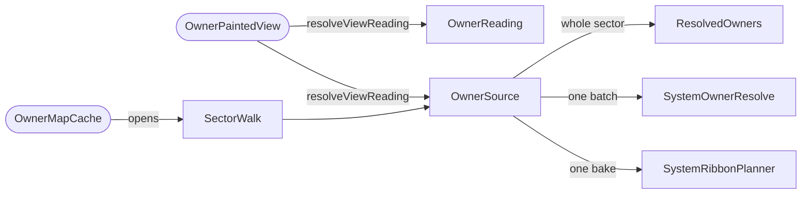

# Owner seams (`ownermap.owners`)

The two questions the owner-map tier asks a layer about its owners -
which systems each one holds,
and how each one looks -
and the one its band plan asks:
which of them stand together in a contest.
Nothing else in the tier knows what an owner is.

Part of [the owner-map tier](../README.md),
in Klark Morrigan's Utilities (KMU);
see the [mod README](../../../../../../../README.md) for project context.

## Index

- [At a glance](#at-a-glance)
- [The walk](#the-walk)
- [Where owners come from](#where-owners-come-from)
- [One system at a time](#one-system-at-a-time)
- [The bands](#the-bands)
- [How an owner looks](#how-an-owner-looks)
- [Who stands together](#who-stands-together)
- [What is not here](#what-is-not-here)

## At a glance

## The walk

A rebuild opens one `SectorWalk`:
the `SectorPassIndex` that walks each system once,
and the visibility rules the cells were cut under,
so a source reads what stands in each system under the rule that decided which systems got cells.
It names no owner and no rule for reading one.
It keeps whatever reading a source opens over it,
one per source,
so the owners, the per-system answers and the band count asked of one walk share one reading
and the source stays a set of rules.

The source is handed the walk rather than the sector,
so whatever it opens over it shares the traversal the cut already paid for.

A walk is one rebuild's or one batch's,
and is discarded with it.

## Where owners come from

`OwnerSource.resolveOwners` answers everything a build reads the sector for,
as one `ResolvedOwners`:

- who owns each system;
- which owned systems draw hatched or unfilled - [the fill states](../render/clusters/README.md#the-split-fill-solid-hatched-unfilled);
- which systems anything stands in, whoever owns them;
- where the spotlit owner lives among the inhabited systems nobody owns.

One value because its five parts are one reading of the sector,
and because they are what a rebuild may keep:
a rebuild owed by a style pick alone paints over the owners the last one resolved
instead of asking the source again.

## One system at a time

An incremental refresh re-derives only the systems a change marked.
Asking the whole-sector answer once per marked system would cost more than the rebuild it replaces,
so the source opens a `SystemOwnerResolve` over the batch's own walk.
It answers three questions of one system:
who owns it,
whether anything stands in it,
and whether the spotlit owner is among what does.

The batch asks the source the standing build was resolved by,
never the view afresh,
so a refreshed cell lands the owner a full rebuild of the same moment would.

## The bands

A presence band explains the fill it sits inside,
so it has to be counted by the rule that painted the cell.
The source answers that too:
`resolveRibbonPlanner` hands the bake its planner over the bake's walk,
once per bake.

## How an owner looks

`OwnerReading` answers each owner's shades,
name,
crest,
recede and category,
the shade an unowned cell paints in,
and the pair a receded one sinks toward.
The pair of shades is KMLib's `ColourPair`,
and `SystemOwner` pairs an owner ID with its pair.

A view answers the reading and the source in one call,
`OwnerPaintedView.resolveViewReading`,
because the two have to agree about what an owner is:
a reading sampled under one live input
and a source resolved under another
would paint owners the source never made.

## Who stands together

`OwnerAffiliation` answers whether two owners are on one side of a contest,
so two allies sharing a system do not band as rivals.
No tier seam asks for it:
a layer's band planner hands it to `OwnerRibbonRuns`.

It is a question apart from which owner a cell is painted for:
a layer can paint two owners apart and still have them stand together.
A layer where nobody does hands over `OwnerAffiliation.NONE`.

## What is not here

- The *answers*.
  A layer states its own source and reading.
  The layers painting holders build theirs through [`holders`](holders/README.md).
- The *categories* an owner draws in are `OwnerCategories`,
  in [`render/style`](../render/style/README.md).
- *Which systems seed a cell* is the substrate's `CellSeedRule`,
  which a layer hands the renderer it composes.
