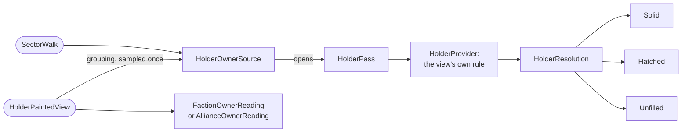

# Holder owners (`ownermap.owners.holders`)

The answers of a layer painting holders:
blocs that hold a system through its colonies.
They fill the tier's [owner seams](../README.md) off one colony pass,
and leave the layer to state only the rules that are its own.

Part of [the owner-map tier](../../README.md),
in Klark Morrigan's Utilities (KMU);
see the [mod README](../../../../../../../../README.md) for project context.

## Index

- [At a glance](#at-a-glance)
- [Why it sits inside the tier](#why-it-sits-inside-the-tier)
- [Kinds over a shared base](#kinds-over-a-shared-base)
- [Alliances add to factions](#alliances-add-to-factions)
- [The word bloc](#the-word-bloc)
- [What a layer states](#what-a-layer-states)
- [One pass per walk](#one-pass-per-walk)
- [One system at a time](#one-system-at-a-time)
- [The band count](#the-band-count)
- [The three fill states](#the-three-fill-states)
- [What is not here](#what-is-not-here)

## At a glance

| Package | What is in it |
| --- | --- |
| `base` | what every holder shares: the colony pass (`HolderPass`) and the rules it reads under, habitation, the grouping seam (`HolderGrouping`), a bloc's shades through its colour faction (`SectorBlocPalettes`), the holder source and the view shape that assembles it, the picker assembly and the standing mode it appends |
| `factions` | one faction as one owner: `FactionOwnerReading`, the four `OwnerMapCategory` values and their styles, the colony count behind a band, the colony size metric, and the colony and faction lines of the hover box |
| `alliances` | a group of factions as one owner: `AllianceOwnerReading`, the contest axis (`BlocAffiliation`, `ContestSides`) and the lines naming a holder's allies and rivals |

## Why it sits inside the tier

Both layers painting holders answer the tier's seams the same way apart from their shades:
they walk the same colonies under the same grouping.
One layer may not import another,
so the shared answers sit where both reach them -
inside the tier,
nested under the seam they fill.

They are a filler of the tier's seams rather than a tier of their own,
which is why the tier's core may not import them.
The layering gate closes the core to this subtree,
and the vocabulary gate closes the core to the words this subtree is about.

## Kinds over a shared base

`base` is what every kind of holder shares.
`factions` and `alliances` are the kinds,
and they are the only siblings of `base`.
A later kind lands beside them,
and shared machinery grows inside `base` rather than beside the kinds -
where a reader could not tell a kind from what the kinds share.
`base` imports neither kind.

## Alliances add to factions

Reuse runs one way:
`alliances` imports `factions`,
and `factions` never imports `alliances`.

An alliance's shades, crest and lone members are read through `factions`.
`alliances` states only what differs:
the group's name,
which member it wears the colours of,
that it always draws at full strength,
and who stands together in a contest.

It adds rather than stands in,
because one view needs both at once:
it paints factions
and judges its contests by alliances.
That only works when an alliance is something added to factions,
not a replacement for them.

## The word bloc

*Bloc* is this subtree's word for an owner:
whatever the grouping folds a colony's owning faction into.
Under the identity grouping that is a lone faction,
and under an alliance grouping it is an alliance.
So *bloc* never means an alliance alone.

The word belongs here and not in the tier's core,
which says *owner* -
a bloc is one kind of owner,
and only this subtree knows what it is made of.
*Alliance* is closed to everything here except `alliances`.

## What a layer states

A view painting holders implements `HolderPaintedView`
and states six parts:

- the grouping that folds factions into blocs;
- who stands together in a contest a band judges, an `OwnerAffiliation`;
- its whole-sector holding rule, a `HolderProvider`;
- where its per-system rule is opened from, a `SystemHolderResolveSource`;
- how a band is counted, a `SystemRibbonPlanner` over one bake's inputs;
- how a bloc looks, an `OwnerReading` over a grouping.

`resolveViewReading` assembles them.
It samples the grouping once
and builds the reading and a `HolderOwnerSource` over that one sampling -
the [one sampling](../README.md#how-an-owner-looks) the seam asks for.

Every part is declared rather than defaulted:
each is one layer's rule,
and a default would put one layer's mechanic in front of every layer painting holders.

The picker is the one exception,
since it is the same for every holder view.
Who a holder view lists is settled by the sector's colonies,
so `HolderPaintedView` reads the colony rules the core's picker seam does not,
assembles the rows,
and appends the standing mode every holder view offers.

## One pass per walk

`HolderOwnerSource` opens a `HolderPass` over the walk the tier hands it:
the walk's own index,
the walk's visibility rule,
the layer's habitation knob,
and the grouping it was built under.
It asks every question about that walk off that one pass.

- **The holding** is the layer's `HolderProvider`, handed the pass and the spotlit bloc.
- **What stands where** is `OwnerMapInhabitation`, over the same pass.
- **Where the spotlit bloc lives** is `SpotlitBlocPresence`,
  asked only of the inhabited systems the holding left to nobody.
- **The band count** is the layer's planner, built over the same pass.

So the holder scan, the habitation scan and the band count read each system once between them,
and cannot disagree about a colony the habitation rule admits.
The walk keeps the pass,
one per source,
which is what lets a bake in the same frame as the build count off the build's pass
while the source itself holds nothing from one walk to the next.

## One system at a time

A batch's walk is a later reading of the sector,
so the source opens a fresh pass for it
and opens the layer's `SystemHolderResolve` over that pass.
The resolve answers who holds a marked system.
Whether anybody lives there and whether the spotlit bloc does are answered off the same pass,
by the same projections the whole-sector scans used,
so a re-derived system cannot leave the map the rebuild put it on.

The holding rule is the layer's to keep in step with its whole-sector rule:
a resolve that lands a different bloc parts the refreshed cell from the rebuild around it.

## The band count

`ColonyCellRibbons`,
in `factions`,
counts every cell on every layer painting holders:
the pass's **habitation projection** of the system's colonies,
folded into a count per bloc under the pass's grouping,
then coloured through the bake's `BlocPaletteReader`.
`RibbonPlanInputs` carries the pass,
the palette port,
the `OwnerAffiliation` the contest is judged against and the laying rules,
so every mechanic of a composed planner counts off a single walk of each system
and judges its contests against one affiliation.

The projection is the pass's `ColonyKnowledge` plus the kind tests habitation turns on:
the fog (`MarketVisibility.isCountedAsColony`),
the gates holding back the shapes a bare fog would leak,
then the derelicts nobody has ever been aboard,
and finally the decivilised worlds where the pass's `DecivilisedColonyHabitation` counts them as unpopulated.
It is the same reading the cell beneath is classified on,
sampled once per bake,
so a colony the player has not found is left out of band
and fill together and the dev reveal puts it back on both.

Habitation and not the wider listing,
which is where a band and the hover box over it deliberately differ.
A run stands for somebody holding something in the system;
an abandoned station the player has seen is named in the box at nought
and has never had anybody on it,
so it raises no run.

Past the projection,
nothing about a colony is asked:
unlisted by the economy,
weighed or never weighed,
each counts as the one colony it is.

One count serves every mechanic because a band reports how a system splits,
which is a fact about the system rather than about the mechanic reading it.
Counted per mechanic,
two layers could answer differently about one system.
What each mechanic still supplies is the **painter** and the **ranking**:
whose fill the band sits inside,
and the order that fill decided.
A bloc the mechanic never ranked draws behind the ranked ones in ID order,
since any place among them would state it took part in a contest it never entered.

## The three fill states

A bloc's footprint always traces as one border.
The fill is what varies per system inside it.
There are three states -
one default and two exceptions:

- **Solid** -
  the default.
  Any owned system not listed as an exception fills solid.
- **Hatched** (`contestedSystemKeys`) -
  a spotlit bloc's presence in a system it does not hold outright:
  "mine,
  but not only mine",
  drawn as a diagonal hatch.
  It states presence and nothing finer,
  so it reads the same whether a rival holds the system or nobody does -
  the alternative being a fourth state drawn for the handful of systems
  where a bloc's only colony is one no mechanic could weigh.
- **Unfilled** (`unfilledSystemKeys`) -
  held for border and label,
  but painting nothing inside the border.
  A rule that extends a bloc's holdings with systems it does not hold draws those systems this way.

When both exception sets are empty,
the whole cluster is solid.
The render split reads that as a fast path,
so a rule that never contests or unfills pays nothing for the split.

## What is not here

- The *rules* -
  the providers and resolves a layer's views state,
  and the mechanics behind them -
  are that layer's own.
  This subtree holds the assembly and the answers every holder layer shares, never a mechanic.
- The *seams* the tier asks through are [`owners`](../README.md)'.
- The *render split* that turns the three states into triangles,
  hatch,
  and skipped fills is [`render.clusters`](../../render/clusters/README.md).
