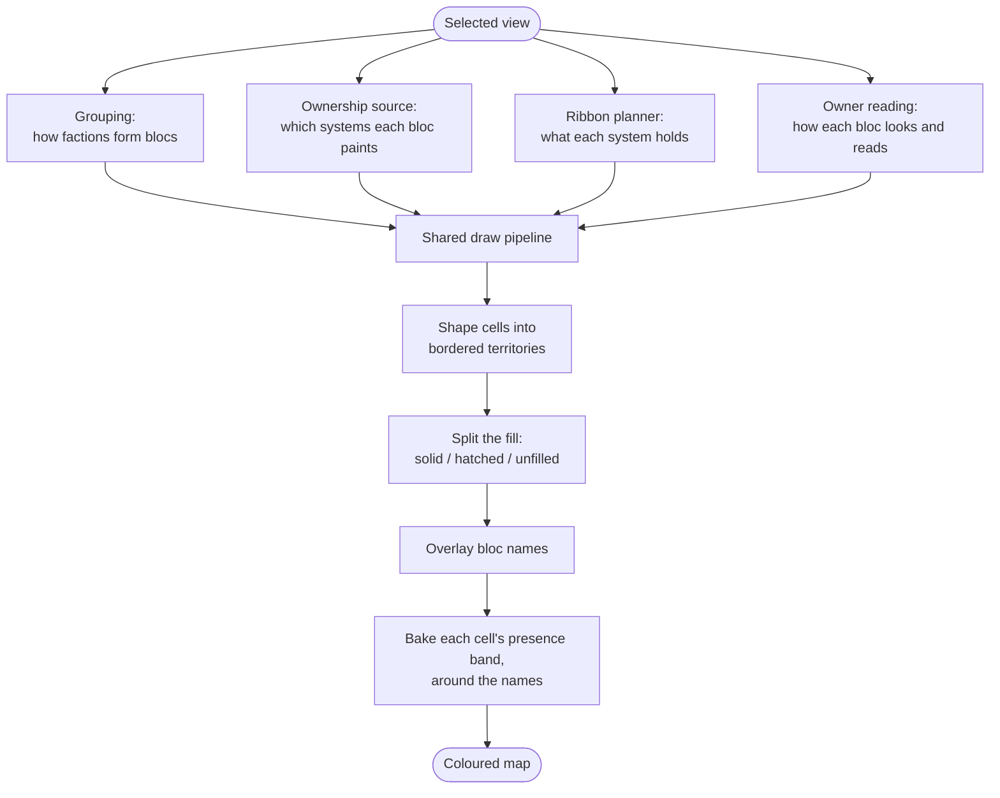

# Political map (`politicalmap`)

An overlay that colours the sector by who controls it.
Each bloc's territory shows as a filled,
bordered,
named cluster over the campaign map,
on the full map screen and on the intel screen's map preview alike.

The political map is one of the layers the tab strip offers;
picking its tab opens a view-selector radio in the body below.
The radio changes *what* "controls" means.
It does not change how the map is drawn.

Part of [map layers](../README.md);
see the [mod README](../../../../../../README.md) for project context.

## Index

- [What the player sees](#what-the-player-sees)
- [The views](#the-views)
- [Claim extensions](#claim-extensions)
- [How a view drives the pipeline](#how-a-view-drives-the-pipeline)
- [The ownership sources](#the-ownership-sources)
- [Where each part lives](#where-each-part-lives)
  - [Refresh](#refresh)
  - [Render orchestration](#render-orchestration)
  - [Hover tooltips](#hover-tooltips)
  - [The presence ribbon](#the-presence-ribbon)
  - [Sidebar controls](#sidebar-controls)
- [When the map is rebuilt](#when-the-map-is-rebuilt)

## What the player sees

For each controlling bloc the overlay draws four things:

- a coloured cluster,
- a border around it,
- faint seams inside it,
- the bloc's name across it.

A system where somebody other than the bloc painting it also has colonies carries a fifth:
a banded stroke running inside that one cell,
a run per colony in the bloc's own colours,
so a cell reads as who is there and in what proportion without the fill having to be split.
A system its painter holds alone -
most of the sector -
bands too,
at one width a colony,
so its cell says how much is there without out-shouting the contested ones.

The tab body picks the view by radio,
and a filter picker below it can spotlight one bloc.
When a bloc is spotlighted,
the rest fade into a muted background.
The radio always lists the views in the same order:
**Factions**,
then **Alliances** (only with Nexerelin),
then **Claims**.

The controls read and write one shared set of values,
so the two screens the overlay draws on always agree on what is painted;
only which tab each screen has lit is its own.
The box those controls sit in -
where it anchors on each screen,
and how it folds away -
is [the sidebar](../base/sidebar/README.md).

## The views

A view is a small set of rules on top of one shared draw pipeline.
Each view answers four questions,
and the pipeline paints the answer without knowing which view asked:

- How do factions group into blocs?
- Which systems does each bloc paint?
- What is in a system,
  for the presence band inside each cell?
- How is each bloc styled and named?

| View | Groups by | Paints | Spotlight targets | Needs |
| --- | --- | --- | --- | --- |
| **Factions** | each faction on its own | held territory, per faction | any faction | always (default) |
| **Alliances** | allied factions fused per alliance | held territory, alliances as one bloc | alliances only | Nexerelin |
| **Claims** | each claiming faction on its own | claimed systems, per faction | any faction that claims a system or lives in one | always |

Notes on each:

- **Factions.** The plain case.
  Every faction is its own bloc.
  Only genuine independent space fades to the muted style.
  A bloc is named after its faction.
- **Alliances.** Allied factions merge into one coloured,
  named cluster per alliance.
  Unaligned factions keep their own border and name.
  Two toggles fade a non-allied faction:
  *Mute* dims it,
  *Desaturate* makes it read as backdrop.
  *Desaturate* starts on so the alliances read as the figure without a settings hunt;
  *Mute* starts off.
  Turn both off and a lone faction looks exactly as it does on the Factions view.
  A sector holding no alliance yet fades nothing whatever the toggles say -
  there is no figure for a backdrop to sit behind -
  so the view reads as the Factions view until the first alliance forms.
- **Claims.** Shows the vanilla "system claimed by faction" mechanic -
  the same claim the colony-survey panel warns about.
  Every claimed system is painted solid in its claimant's colours.
  There is no alliance grouping here.
  The spotlight list ranks by claim count and market size rather than by domination,
  and it takes one faction the general rule below would not reach:
  a claimant holding no colony anywhere lives nowhere and paints here all the same,
  so it is listed on the strength of its claims.
  Under the default claims-descending sort the rows greyed for claiming nothing form a tail below the claimants;
  sorting by name interleaves them.
  A claimant's systems already share one border and one colour with no filter on,
  so what spotlighting adds here is the contrast:
  the picked claimant keeps its full strength
  while every other claimant fades into the muted background.
  Systems the pick *lives in without claiming* keep their strength too -
  in the neutral,
  unclaimed paint they carry off filter,
  never the pick's colours -
  so a faction that claims nothing still shows where it is while showing that it claims none of it.
  Nothing hatches:
  a system has exactly one claimant,
  so no claim can be contested the way a held system can.
  Hovering a system explains its claim:
  who holds it,
  who stands in the holder's alliance,
  who is on good terms with it without standing in that alliance,
  who contests it,
  who is present but can never claim it,
  and whether the hold was won on market strength or imposed by decree.

## Claim extensions

The Factions and Alliances views do not only paint held cells.
A system a faction *claims* but does not *hold* joins that faction's territory drawn empty:
inside the border and under the faction's name,
but with no fill.
The Claims view instead paints those same claims solid.
Why a claim resolves this way is [the ownership sources](#the-ownership-sources);
how the empty fill is drawn is [cluster fills and borders](../ownermap/render/clusters/README.md).

## How a view drives the pipeline

Every view resolves ownership through one seam.
The pipeline reads who-paints-what from that one source,
and never branches on which view is active.

The bands come after the names rather than before them because they are laid *around* them:
a name is fitted inside the border its cluster's cells trace,
so it has no place until the cells are shaped,
and a band baked before that would run under a word.
Baked last,
each band carves the names' boxes out of its cell's ring and lays its runs along what is left -
or carves nothing,
where the player would rather have the whole band and let the name draw across it.
Either way the pass runs last,
so the ordering is what makes the choice available rather than what settles it.

What changes between views is only those four inputs;
from the seam on,
every view shapes,
fills,
bands,
and labels identically.
The sources themselves are [below](#the-ownership-sources);
the seam they answer is [ownership resolution](../ownermap/owners/holders/README.md),
and the three fill states are [the split fill](../ownermap/render/clusters/README.md#the-split-fill-solid-hatched-unfilled).

The fourth input, the owner reading, is where the views differ least.
The Factions and Claims views read a bloc with `FactionOwnerReading`,
off the faction whose ID it is.
The Alliances view reads one with `AllianceOwnerReading`:
an alliance by its own name in its colour faction's shades,
never receding,
and a lone faction through `FactionOwnerReading`,
receding behind the alliances wherever one exists.
So a lone faction reads the same on all three views.
What a reading answers is the [owner-map tier's](../ownermap/README.md#what-a-layer-supplies).

The third input is the second one layer along:
a view's cells are painted by some mechanic,
and its bands have to be *counted* by that same mechanic or they contradict the fills they sit inside.
It carries no default on the view seam,
deliberately -
a default would name one mechanic's planner in front of every view,
including the ones that mechanic does not paint.
The contest-painted views answer it once between them on `DominancePaintedView`,
and the claims view answers with its own.

What the three views answer alike is stated once,
on `PoliticalHolderView`,
which every view of this layer extends:

- the alliance set's revision as the content revision they repaint on;
- the live alliance set as who stands together in a contest,
  whatever a view paints as one bloc;
- the holder categories;
- the faction reading,
  which only the Alliances view replaces.

It sits below the holder seam rather than on it,
since these are this layer's choices of input and look.

The spotlight list runs on the same principle one level down.
`OwnerPaintedView` asks a view for its picker -
the blocs on offer *and* its mechanic's vocabulary for ranking them -
so the metrics a view's rows carry can never drift from the modes offered to sort them by,
and the sidebar above passes the pair on without naming either.
The shared assembly then widens that vocabulary by one,
the ranking by standing with the player below,
and every holder view reads it over one sampling of its grouping,
so the walk's numbers and the rows naming them come off one membership.
Factions and Alliances are painted by the same contest,
so `DominancePaintedView` answers that once for both
and leaves them only the one thing they differ on,
which is the Spotlight targets column above.
A view painted by another mechanic implements `PoliticalHolderView` directly
and pairs its own list with its own vocabulary rather than widening theirs.

A vocabulary states only its numbers,
the key and label each is offered under,
and the order ties break down them.
What a mode then is,
is `OwnerMetricSortMode`;
how its declaration becomes a ranking -
the chosen metric first,
the rest of the chain behind it,
then the name and the bloc ID -
is KMLib's `ListSortComparators`,
which `OwnerSortModeComposer` hands each metric read off the bloc's stats.
So the numbers stay one layer's while the shape of the ordering,
and the tail that keeps a fully-level pair from reshuffling,
are the same under every view.

One number is not one layer's,
though:
a bloc's whole-sector colony size is the same sum off the same habitation projection whichever mechanic paints the map.
It is stated as a capability the metrics opt into,
`SizedBlocMetrics`,
and its mode is asked for from `SizedBlocMetrics.createMarketSizeMode` rather than declared twice.

Where a bloc stands with the player is not a metric at all,
and the ranking by it lives with the picker every holder view shares:
see [standing with the player](../ownermap/owners/holders/README.md#standing-with-the-player).

What every picker lists is who *lives* somewhere the map draws,
which is the same reading of a system the cells are painted from and the bands counted from -
not who the layer's mechanic weighed.
So a faction whose only colony the economy never registered is offered,
and so is **Neutral**,
which is what a revealed decivilised world is owned by.
A bloc whose only holding is a derelict nobody lives on is not:
a spotlight lights territory,
and there is none to light.

A player who has switched *Decivilised systems - should draw territory* off has made such a world derelict-shaped for this purpose,
so the rule just stated carries Neutral out of the picker wherever those worlds were its only presence.
That is the rule applying rather than a loss to make up for:
switching it off is the statement that such a world is nobody's presence,
and there is then none to light.
Neutral stays listed wherever it holds something else - an economy-listed station among them.

A listed bloc that paints nothing on the layer greys,
and stays pickable:
it is listed because it is present,
greyed because there is nothing here to light.
What "nothing" counts as is the layer's own metric -
no claim on Claims,
no dominance weight on the two the contest paints -
so it is one rule read against whichever number that layer paints by.
The bloc's metrics carry the answer,
through `PaintingOwnerMetrics`,
which a picker of painters opts into and any other picker leaves alone.

## The ownership sources

Every view of this layer paints holders,
so each states its holding rule to the tier's [holder source](../ownermap/owners/holders/README.md),
which answers the tier's owner seams off one colony pass.
Three providers are those rules,
all of them this layer's own and all in `holders`:

- **`DominanceHolderProvider`** -
  held systems from the live economy.
  No view resolves through it bare:
  the source below wraps it for the Factions and Alliances views.
  Off filter,
  each system goes to its single strongest owner,
  with no exceptions,
  by [the market contest](dominance/README.md#who-holds-a-system)'s rule.
  Under a spotlight it switches to [the presence-aware resolver](dominance/README.md#under-a-spotlight):
  the chosen bloc stays drawn wherever it holds a colony -
  solid where it wins,
  hatched where it does not.
- **`ClaimAugmentedHolderProvider`** -
  the Factions and Alliances views' source,
  through `DominancePaintedView`.
  It takes held systems from the source above,
  then folds in each claimed-but-unheld system as an *unfilled* extension of its claimant.
  The claim carries the same bloc key as that faction's held systems,
  so the geometry fuses held and claimed cells into one bordered cluster.
  A system already held keeps its solid fill:
  the held signal wins.
  Under a spotlight,
  a claim shares the fate of its bloc -
  the spotlit bloc's claims stay at full strength,
  every other bloc's claims fade with its held cells.
- **`ClaimsHolderProvider`** -
  the Claims view's source.
  Every claimed system is painted *solid* in its claimant's colours,
  with nothing held-derived.
  Under a spotlight the chosen bloc's claims stay at full strength and every other claimant's fade,
  the same trade the source above makes.
  A system has one claimant,
  so nothing is ever contested or unfilled here:
  the resolution has no exceptions and takes the solid fast path on or off filter.

Both claim-reading sources get their claims from [`FilteredClaims`](claims/README.md#under-a-spotlight),
so which claims a spotlight moves is answered once rather than once per source.
Each reads them through the claim reader source its view hands it,
the one the view's bands and hover box read through too;
see [one reader per pass](claims/README.md#one-reader-per-pass).

An incremental refresh re-derives one system at a time,
through a per-system resolve each view states,
also in `holders`.
The two dominance views state `DominanceSystemHolderResolve`:
the market contest asked of one system over the batch's own pass,
under one weighting rule sampled per batch,
so a single-system refresh lands the bloc the bulk pass would have.
The Claims view states `ClaimSystemHolderResolve`:
the claimant of one system,
read through the same claim reader and folded and coloured by the same rule
`SectorClaims` applies to the whole sector,
so a colony event in a claimed system keeps it on its claimant.

## Where each part lives

This layer's rules are divided by *mechanic*,
not by view:
`dominance` is the market contest and `claims` is its peer,
the vanilla claim mechanic.
Each holds its rule,
its whole-sector stats and the sort modes over them,
its band ranking and its hover box.
The views and the holder sources sit beside the mechanics rather than inside one,
in `views` and `holders`:
they are this layer's answers to the tier's seams,
and they compose the mechanics -
the Factions and Alliances holding folds claims onto held dominance -
so shelving them under either mechanic would make that mechanic name the other.

| Package | What is in it |
| --- | --- |
| *(top level)* | the tab (`PoliticalMapLayer`), what it stands up on a sector (`PoliticalMapStanding`, `PoliticalMapInstaller`) |
| `views` | the three views (`FactionsView`, `AlliancesView`, `ClaimsView`), every view's shared answers (`PoliticalHolderView`), and the contest-painted views' (`DominancePaintedView`) |
| `holders` | the holding rules the views state to the tier's holder source: the three [ownership sources](#the-ownership-sources) and the two per-system resolves, `DominanceSystemHolderResolve` and `ClaimSystemHolderResolve` |
| [`dominance`](dominance/README.md) | the market contest: the pass, `SectorPolitics`, `FilteredPolitics`, `SystemDominance`, the tie-break and the ranking rules, `BlocCandidacy`, the stats and sort modes |
| `dominance/weighting` | what one colony is worth (`MarketWeights`, its breakdown and factors) and the rules it is weighed under, and the footprints folded from them (`KnownMarketFootprints`), stated in [the market contest](dominance/README.md#what-a-colony-weighs) |
| `dominance/standings` | one hovered system's ranked standings, per group and per faction |
| [`dominance/ribbon`](dominance/ribbon/README.md) | the band ranking on a cell the contest painted |
| [`dominance/tooltip`](dominance/tooltip/README.md) | the domination box |
| [`claims`](claims/README.md) | the claim mechanic: `SectorClaims`, `FilteredClaims`, `PassClaimReaders`, the stats and sort modes |
| [`claims/ribbon`](claims/ribbon/README.md) | the band ranking on a claims-layer cell |
| [`claims/tooltip`](claims/tooltip/README.md) | the claims box |
| [`tooltip`](tooltip/README.md) | what both box families share: `PoliticalMapCellTooltip` with the decree read it heads every box with, `CoreTerritoryHeading`, the contest wording, the status line (`SystemStatusRow`), and the colony lines - a system's colony reading (`SystemColonyReading`) with the qualifier and the observation notes it lays on them |
| [`refresh`](refresh/README.md) | what repaints the overlay while the campaign runs |
| `render` | the player's draw-order choices, read as the tier's band layout |

What sits in [`ownermap`](../ownermap/README.md) is what every mechanic shares:
the view seam itself,
the pipeline the seam feeds,
and the vocabulary both sides state their answers in.
That tier is not this layer's,
which is why it is a package of its own,
and the build keeps it from naming this one.

- **[Ownership resolution](../ownermap/owners/holders/README.md)** -
  the per-view ownership seam
  and what lands in each fill state.
- **[Cluster fills and borders](../ownermap/render/clusters/README.md)** -
  how cells become each bloc's coloured cluster,
  border,
  seams,
  and split fill.
- **[Render style layer](../ownermap/render/style/README.md)** -
  how player settings become each territory's colours,
  widths,
  and opacities.
  The four categories this map divides its cells into are the holders' own,
  `HolderCategory` in [`owners/holders`](../ownermap/owners/holders/README.md).
- **`ownermap/render/labels`** -
  what a cluster's name reads and what shade it draws in:
  the active view's name for the bloc,
  and the outer border its group inherits.
  Both are resolved there and handed to the framework's overlay,
  which places and draws them.

Everything above is drawn over the systems the framework's `base/visibility` admits,
shaped out of [cell geometry](../base/geometry/README.md),
styled against the [theme records](../base/theme/README.md),
named by the [cluster-name overlay](../base/labels/README.md),
and hovered through `base/hover` -
all of which belong to the framework rather than to this layer:
they work on an opaque owner,
and the views decide that the key names a bloc.

The supporting parts take a subsection each below:
this layer's `refresh`,
the render seams it answers,
the hover boxes,
the presence ribbon,
and the sidebar.

### Refresh

[`refresh`](refresh/README.md) repaints the overlay while the campaign runs:
the layer's own staleness poll,
the listeners that turn economy events into targeted marks,
and the alliance signal only this layer raises.

### Render orchestration

The frame is the substrate's -
see [the frame sequence](../base/render/README.md#the-frame-sequence) -
and the order the sub-layers stack in and the incremental refresh are the tier's -
see [the owner-map tier](../ownermap/README.md#where-each-part-lives).
What this layer hands over are its answers to the tier's render seams
([what a layer supplies](../ownermap/README.md#what-a-layer-supplies)),
all of them where `PoliticalMapLayer` builds its renderer:

- **`PoliticalMapBandLayoutReader`**,
  in `render` -
  which side of the map's own nebulae each choosable sub-layer paints on,
  read per pass from the player's four **Nebula draw order** settings.
- **`SharedOwnerMapHoverGates`**,
  the tier's -
  whether the layer answers the cursor at all.
  This layer has no hover switches of its own,
  so it reads the one shared set of owner-map switches.
- **`SpotlightPreviewHighlightRenderer`**,
  the tier's -
  what hovering a row of the spotlight picker lights,
  built over this layer's ID and `KmuMod.MAP_STORE_NAMESPACE`,
  the namespace its picker stores its picks and reports its hover under.
  It goes to the tier's compositor and deliberately not to the frame sequence:
  the sequence taking it would state that every layer has a picker with a hover preview,
  which is false.
- **`CellSeedRule.SEED_DRAWN_SYSTEMS`**,
  the substrate's -
  which systems seed a cell.
  This layer seeds one for every system the map draws,
  and states it rather than inheriting it.

Who owns each system is not handed to the renderer at all:
every view answers it through `resolveViewReading`,
which the tier asks per rebuild and the diagnostic overlays share.

### Hover tooltips

Each view injects into the framework's hover box the explanation of the mechanic its own fills were painted by:

- **[The domination box](dominance/tooltip/README.md)** -
  `SystemDominationTooltip`,
  the ranked standings behind a faction or alliance fill.
  The Factions and Alliances views each hold one,
  bound to that view's grouping,
  so the standings are ranked under the view that painted the fills beneath them.
- **[The claims box](claims/tooltip/README.md)** -
  `SystemClaimTooltip`,
  the scored claim contest behind a claims fill.
  The Claims view holds one,
  reading through the view's own claim reader source,
  so the box names the claimant the fill was painted for.
- **[The shared box shape](tooltip/README.md)** -
  what both are written from:
  the decree heading,
  the relations every box samples per hover,
  the status line,
  the words a colony's line calls out,
  and the last-seen remark.

### The presence ribbon

The band's runs and its gate are the tier's:
the [runs](../ownermap/ribbon/README.md)
and the [bake](../ownermap/render/ribbon/README.md).
Its geometry and draw are the substrate's,
in [`base.ribbon`](../base/ribbon/README.md).
What this layer supplies is where a band's order comes from,
which is each painting mechanic's own business
and keeping it there is what makes one band mean one thing on every view:
[held cells](dominance/ribbon/README.md),
ranked off the very footprints the fill was ranked from,
and [claims-layer cells](claims/ribbon/README.md),
ranked off the contest over the system -
the cells no claim covers among them,
since the claim walk never sees a hidden or player-owned market
and a band is the only thing that reports those systems.
Which of the two answers for a cell is the view's own call,
made through the same seam it picks its holder source and its hover box by.

Where the bands are drawn is this layer's too:
`PoliticalMapBandLayoutReader` reads the player's **Nebula draw order** setting for the presence bands into the `OwnerMapBandLayout` it hands the tier.
It ships as **Below**,
with the fills and borders the bands are laid on,
and only the names rise clear of the nebulae:
the nebulae decide whether a reader gets a word at all,
where a shape they dim is merely quieter.
The setting exists because how much a dimmed band loses depends on the palette it is read against.

### Sidebar controls

The body controls are the tier's `ownermap/sidebar`
([the owner-map tier](../ownermap/README.md#where-each-part-lives)):
the shared sub-options,
the view selector,
the recede toggles (`RecedeControl`)
and the memo behind the spotlight picker (`SelectableOwnerCache`).
The box they sit in and the picker itself are reached through [the sidebar](../base/sidebar/README.md)
(the picker is KMLib's,
bound to this mod's save slots there).
What stays here is this layer's answers:
`PoliticalMapLayer` lays its body out -
the shared sub-options,
the view selector,
the spotlight picker paired with the filter recede,
then the selected view's own controls -
and `AlliancesView` binds its own Mute and Desaturate toggles to the shared recede control,
shown only while that view is selected.

The class that names and orders the views is `kmu.maplayers.MapLayers`,
also one level up;
how a layer is picked and what each screen remembers is [map layers](../README.md).

## When the map is rebuilt

Nothing above is redrawn from scratch per frame.
The overlay holds its cells,
its territories,
and its labels,
and a frame's normal cost is a few int compares against the revisions each was built against.
A colony changing hands re-shapes that system and its neighbours;
a settings or toggle change restyles over the standing cells;
only a change to the *set* of drawn systems rebuilds the partition.

[The caching notes](../../../../../../docs/dev/caching.md) own that model in full -
the signals,
the caches,
and the four rebuild paths.
